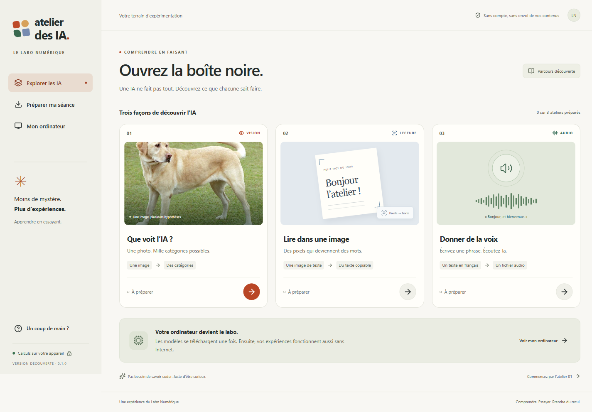

# Atelier des IA

**Découvrez plusieurs intelligences artificielles en les essayant sur votre ordinateur.**

**Prototype en validation : ce dépôt contient le code et la documentation. Aucune version installable n’est encore publiée sur GitHub.** Consultez [l’état des essais](docs/VALIDATION.md) avant une utilisation en cours.

Pas de compte, pas de clé à créer, pas de commande à saisir. Les calculs utilisent votre ordinateur. Vos contenus ne sont pas envoyés à un service d’IA.

Cette première version propose trois expériences :

| Atelier             | À vous de jouer                                                    |
| ------------------- | ------------------------------------------------------------------ |
| Que voit l’IA ?     | Choisir une photo et comparer les catégories proposées.            |
| Lire dans une image | Transformer une note ou un ticket en texte copiable.               |
| Donner de la voix   | Écrire une courte phrase française et écouter sa voix synthétique. |

## Commencer

1. Ouvrez **Atelier des IA** avec son raccourci.
2. Choisissez un atelier puis **Télécharger et tester**. L’application affiche le téléchargement et vérifie le modèle sur votre poste.
3. Choisissez un exemple ou écrivez votre phrase, puis lancez le calcul.
4. Comparez le résultat et ouvrez **Et sa limite ?**.

Les exemples sont fournis. Aucun accès à la caméra ou au microphone n’est demandé dans cette version. La voix est générée à partir de votre texte ; ce n’est pas un enregistrement préparé.

## Avant un cours

Ouvrez **Préparer ma séance**, sélectionnez les ateliers puis préparez-les pendant que vous avez Internet. Une fois les ressources téléchargées, les expériences fonctionnent hors ligne.

Pour une classe, **Créer un pack** copie les modèles disponibles dans un dossier. Transférez ce dossier sur une clé USB. Sur l’autre ordinateur, choisissez **Importer un pack**, puis préparez la sélection : chaque poste doit faire son propre test. Un pack d’une autre version peut être refusé.

## Si cela ne fonctionne pas

- **Le modèle ne se télécharge pas :** vérifiez Internet et réessayez. Le téléchargement reprend lorsque c’est possible.
- **Le calcul est lent :** fermez les applications inutiles. Le bouton **Annuler** arrête le calcul. Essayez ensuite un autre atelier.
- **Vous manquez de place :** utilisez la corbeille dans **Préparer ma séance**. Les packs exportés et les fichiers audio que vous avez enregistrés sont conservés.
- **Vous voulez vérifier votre poste :** ouvrez **Mon ordinateur**. Un test réussi est un repère à un moment donné, pas une garantie permanente.

Les ateliers ont des limites : une catégorie peut être fausse, un caractère mal lu, un nom mal prononcé. Les exemples faciles et difficiles servent à comparer ces comportements.

## Installation et disponibilité

Version **0.1.0 — prototype local**. Un installateur Windows d’environ 148 Mo a été construit localement. Il n’est pas inclus dans ce dépôt et n’est pas encore proposé en téléchargement. Les dossiers de compilation et les modèles téléchargés sont exclus de Git.

Les trois ateliers fonctionnent avec le runtime Electron de développement. Sur ce poste, la dernière version empaquetée est bloquée au lancement par la politique Windows Device Guard : une signature valide ou une autorisation informatique adaptée est nécessaire. Aucune protection du poste n’a été modifiée. Aucune page de téléchargement publique n’est publiée ; la signature, les licences restantes et l’installation sur postes propres doivent être validées avant diffusion aux apprenants.

La cible est un ordinateur sans carte graphique dédiée, avec 8 à 16 Go de mémoire. **Les essais sur de vrais portables de 8 et 16 Go restent nécessaires.** Les paquets Mac et Linux ne seront annoncés compatibles qu’après validation sur ces systèmes.

Consultez [l’état réel des vérifications](docs/VALIDATION.md), [les crédits des exemples](docs/MEDIAS.md) et [les modèles et licences](THIRD-PARTY-NOTICES.md).

## Pour la personne qui entretient l’application

Les instructions de programmation, de compilation et de création des installateurs sont dans le [guide de maintenance](docs/DEVELOPPEMENT.md). Elles ne sont pas nécessaires pour utiliser l’application installée.

L’Atelier des IA est indépendant du cours, du Harnais et du plugin Labo UX. Le panorama complet des ateliers prévus est dans le [plan de réalisation](docs/PLAN.md).
